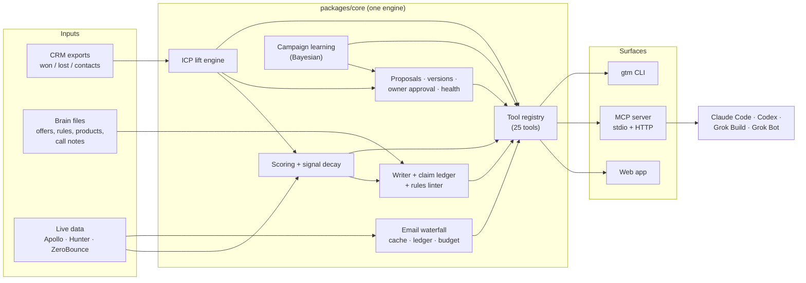
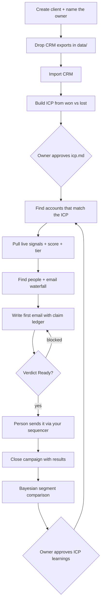

# GTM Brain

**One brain per client that every AI agent and every teammate reads.**

GTM Brain holds what a sales team knows about a client: who buys (proven from won and lost deals), what they sell, what they must never say, what buyers said on calls, and what every past campaign taught them. Deterministic engines and live data sit on top, so every number comes with its evidence and every email sentence comes with its source.

It works three ways from one engine:

| Way in | Who it's for | Start it with |
|---|---|---|
| **Web app** | The agency team and clients | `npm run dev`, then open http://localhost:3000 |
| **AI agents (MCP)** | Claude Code, Codex, Grok Build, Grok Bot | Open the folder in your agent, or `npm run mcp:http` for Grok Bot |
| **`gtm` command line** | Operators who live in a terminal | `npm run gtm -- help` |

All three call the same tool registry, so every surface gives the same answer.

---

## Contents

- [The problem it solves](#the-problem-it-solves)
- [What you get](#what-you-get)
- [How it works](#how-it-works)
- [Quick start (10 minutes)](#quick-start-10-minutes)
- [Ways to use it, step by step](#ways-to-use-it-step-by-step)
  - [1. Web app](#1-web-app)
  - [2. Claude Code](#2-claude-code)
  - [3. Codex](#3-codex)
  - [4. Grok Build](#4-grok-build)
  - [5. Grok Bot (connects by URL)](#5-grok-bot-connects-by-url)
  - [6. The `gtm` command line](#6-the-gtm-command-line)
- [Onboarding a real client](#onboarding-a-real-client)
- [A typical week](#a-typical-week)
- [The engines, explained](#the-engines-explained)
- [Data formats](#data-formats)
- [Reference: tools, skills, commands, pages](#reference)
- [Configuration](#configuration)
- [Security and trust model](#security-and-trust-model)
- [Project structure](#project-structure)
- [Development and testing](#development-and-testing)
- [Troubleshooting](#troubleshooting)
- [FAQ](#faq)
- [Roadmap](#roadmap)

---

## The problem it solves

AI agents can now research accounts, write cold emails, and run campaigns. But an agent is only as good as what you feed it, and most teams feed it badly:

| Real problem | What happens today | What GTM Brain does |
|---|---|---|
| **The ICP is a guess.** It lives in someone's head or a slide. | Agents target "B2B SaaS, 50–500 people" because that's what the prompt said. | It builds the ICP from closed-won vs closed-lost deals with statistics. Every trait shows its lift and confidence, plus what to avoid. |
| **Every agent has different context.** | Claude Code, Codex, Grok and the team each work from different notes and prompts. | One brain folder per client, read by every agent through the same tools and the same `AGENTS.md`. |
| **AI copy invents things.** | Fake numbers, wrong customer names, claims legal never approved. | A claim ledger: every sentence must cite a source. Invented numbers or names **block** the draft. `rules.md` is enforced in code. |
| **"Why is this account Tier 1?"** | Black-box scores nobody trusts. | Scores are split into fit (up to 60) and buying signals (up to 40), with every reason listed. Signals fade with age. |
| **Data credits leak.** | The same contact is enriched five times; nobody knows the monthly spend. | An email waterfall that stops at the first verified result, a cache shared across clients, a per-call cost ledger and a hard monthly budget. |
| **You email your own customers.** | Prospecting lists include current customers and open deals. | CRM suppression: customers, open deals and do-not-contact records are never prospected or enriched. |
| **Nobody learns from campaigns.** | Results sit in the sequencer; the next campaign starts from zero. | Closing a campaign writes it into the brain and compares segments with Bayesian statistics. You get "scale / test more / explore / stop". |
| **Agents quietly rewrite the strategy.** | An agent edits the ICP or the rules and nobody notices. | Core files change only through proposals with a diff. One human owner approves. AI agents can propose but can never approve. |

**Who it's for:** GTM and outbound agencies running many clients, RevOps and growth teams, and founders who sell, especially anyone already using Claude Code, Codex or Grok for go-to-market work.

---

## What you get

- **Evidence-based ICP.** Lift and a significance test for every trait (industry, size, region, tools, the signer's seniority and function) across won vs lost deals. It writes `icp.md` with the numbers on every line and a diverging lift chart in the app.
- **Account scoring with reasons.** ICP fit (0–60) plus signal intent (0–40), where each signal decays with its own half-life. Tier 1/2/3, with suppression built in.
- **Live data.** Apollo for companies, people, enrichment, job postings and funding. Hunter and ZeroBounce for finding and verifying emails.
- **Email waterfall.** ColdIQ (or Apollo) first, and it stops as soon as an email is verified; then the finder, then the verifier. Every step is shown with its credits.
- **Signal-first prospecting.** Search for companies that raised money this year (`funded_since_year`). Stale signals never open an email.
- **Fact-checked email writing.** Claude writes from numbered sources (signals, proof, product facts, buyer quotes). A deterministic checker then gives each draft a verdict: **Ready**, **Needs review** or **Blocked**.
- **Copy rules in code.** Word limit, no links, question count, banned words (including their forms, e.g. "leverage" also catches "leveraged"), banned claims, spam triggers, AI tells and unfilled placeholders.
- **Learning loop.** Closing a campaign writes `past-campaigns/` and computes positive-reply rates per segment and angle, with 95% ranges and the probability each segment is the real winner.
- **Owner approvals.** Proposals with a line diff, history of every version, rollback, and a stale-change guard.
- **Brain health.** A score out of 100 with the exact fix for each gap, including ICP drift detection.
- **Spend control.** A cost ledger, cache hit rate, and a monthly credit cap per client.
- **Batches of 100.** Scoring stops after the first 100 so a person can check them, then resumes where it left off.
- **Multi-client.** Each client gets its own folder, owner, budget and history.
- **Starts clean.** A fresh clone has no clients and no sample data. Nothing made-up is ever shown as real: without an Apollo key, data tools stop and say which key to add.

---

## How it works



**The flow for one client:**



**Where things live:**
- **Brain files** (human-readable Markdown, one folder per client): `workspaces/<client>/`
- **Database** (accounts, contacts, drafts, campaigns, proposals, versions, ledger, cache): `data/gtm.db`. This is SQLite built into Node, so there's nothing to install.
- **Keys:** `.env.local` only. Never inside `workspaces/`.

---

## Quick start (10 minutes)

**You need** Node.js **22.13 or newer** (it uses the built-in `node:sqlite`) and Git.

```bash
git clone https://github.com/thoughtpilot99/gtm-brain-agency.git GTM-Brain
cd GTM-Brain
npm install
npm run setup        # creates .env.local and syncs skills (no sample data is loaded)
npm run dev          # open http://localhost:3000
```

The app opens with no clients. Add your first one on the home page (or with `npm run gtm -- init "Acme" --owner "Your Name"`), then follow [Onboarding a real client](#onboarding-a-real-client).

**Add your keys** to `.env.local` and restart the app:

```bash
ANTHROPIC_API_KEY=...    # Claude: email writing, ICP summary, "Ask the brain" chat
COLDIQ_API_KEY=...       # recommended: ONE key for companies, people, emails, verification, signals
APOLLO_API_KEY=...       # alternative to ColdIQ: companies, people, enrichment, job postings, funding
HUNTER_API_KEY=...       # email finder (+ verifier)
ZEROBOUNCE_API_KEY=...   # email verifier (used first if set)
```

| Keys present | What runs |
|---|---|
| None | Brain files, CSV import, ICP, scoring on ICP fit, approvals, campaign learning and the template email writer all work. Company and people search, signals and email finding stop with a message asking for the key. |
| `ANTHROPIC_API_KEY` | Claude writes the emails and the ICP summary, and "Ask the brain" chat turns on. |
| `COLDIQ_API_KEY` | Real companies, people, enrichment, email finding + verification and funding, all through ColdIQ's 40+ providers on one bill. Used instead of Apollo and Hunter when set. |
| `APOLLO_API_KEY` | Real companies, people, enrichment and signals (when ColdIQ isn't set). |
| `HUNTER_API_KEY` / `ZEROBOUNCE_API_KEY` | Real email finding and verification in the waterfall. |

---

## Ways to use it, step by step

### 1. Web app

**Best for:** showing clients, reviewing lists and drafts, approvals, and anyone who doesn't use a terminal.

1. Run `npm run dev` (or `npm run build && npm run start` for the faster production version).
2. Open http://localhost:3000.
3. **Home:** every client with its health score, ICP status, Tier 1 count, meetings, pending approvals and data mode. **Add a client** sits here, along with which API keys are connected.
4. Pick a client. The sidebar has every section:

| Page | What it's for | What you can do |
|---|---|---|
| **Overview** | One-screen status | Key numbers, the ICP lift chart, accounts to work first, segments to run next, health gaps, and a link to pending approvals |
| **Brain files** | The files agents read | View any file. Edit notes directly; protected files become a proposal. Health checklist with fixes. |
| **ICP** | Who buys and who doesn't | Full diverging lift chart, the ICP as a company search, traits to avoid, and Rebuild |
| **Accounts** | Ranked target list | Find 25 ICP matches, refresh signals and score (100 at a time), filter by tier, search |
| **Account page** | Everything about one company | Why it scored what it did, its signals (each with its points and half-life), people, finding emails with the full waterfall trace, writing an email |
| **Writer** | Fact-checked first emails | Write for any Tier 1/2 account. The email, its verdict, the **claim ledger** (each sentence with its source ids) and the sources list |
| **Campaigns** | The learning loop | Segment results with 95% ranges and P(best), angle comparison, run-next recommendations, and a form to close a campaign (totals or a results CSV) |
| **Approvals** | The owner's queue | Line diffs, approve or reject (owner name required), decision history, version history with Restore |
| **Spend** | Cost control | Credits and dollars this month, budget bar, daily spend, cost by provider and action, cache hit rate, latest calls |
| **Ask the brain** | Chat | Ask in plain English. Claude calls the same tools live and shows each call. Needs `ANTHROPIC_API_KEY`. |

5. **Dark mode:** the toggle is at the bottom of the sidebar. Light (grey-white with black buttons) is the default.

### 2. Claude Code

**Best for:** operators doing GTM work in natural language, with skills for repeatable jobs.

1. Install Claude Code, then open the project:
   ```bash
   cd GTM-Brain
   claude
   ```
2. Claude Code reads `CLAUDE.md`, which imports `AGENTS.md` (the rules for every agent).
3. It finds the **`gtm-brain`** MCP server in `.mcp.json`. Approve it when asked; `/mcp` shows its status.
4. Talk to it, or run a skill:
   ```
   /brain-review acme
   /signal-hunt find 25 new accounts for acme
   /first-line write the first email for example.com
   /close-campaign
   ```
5. Example requests:
   - "Show me acme's Tier 1 accounts and why each one is Tier 1."
   - "Find the VP of Sales at example.com and verify their email."
   - "Propose adding 'quick question' to the banned words in rules.md."

Claude Code can propose brain changes but cannot approve them. The owner approves in the web app or with `gtm approve`.

### 3. Codex

1. Open the folder in Codex and trust it. Codex reads `AGENTS.md` automatically.
2. The MCP server is registered in `.codex/config.toml`. If your Codex version ignores project config, run:
   ```bash
   codex mcp add gtm-brain -- node --import tsx apps/mcp/src/stdio.ts
   ```
3. Skills are in `.agents/skills`. Run them with `$` instead of `/`: `$first-line`, `$score-accounts`, `$signal-hunt`.

### 4. Grok Build

1. Start `grok` in the project folder. It reads `AGENTS.md` and `CLAUDE.md`, and picks up Claude Code's skills from `.claude/skills` automatically (check with `grok inspect`).
2. Add the server:
   ```bash
   grok mcp add gtm-brain -- node --import tsx apps/mcp/src/stdio.ts
   ```
   Then type `/mcps`, select `gtm-brain`, and connect.
3. Run skills with `/first-line` and so on, the same as in Claude Code.

### 5. Grok Bot (connects by URL)

Grok Bot runs on its own cloud computer, so it can't reach `localhost`. It needs a public HTTPS URL that tunnels to your machine, protected by a secret token.

1. **Start the HTTP MCP server:**
   ```bash
   npm run mcp:http
   ```
   It listens on `http://127.0.0.1:8787/mcp`. On first run it creates a secret `GTM_MCP_TOKEN` and saves it in `.env.local`.
2. **Open a tunnel** to port 8787 in a second terminal (install one first):
   ```bash
   cloudflared tunnel --url http://localhost:8787     # free quick tunnel, prints https://xxxx.trycloudflare.com
   # or
   ngrok http 8787
   ```
3. **Send Grok Bot this message:**
   > Add the MCP server at https://xxxx.trycloudflare.com/mcp/YOUR_GTM_MCP_TOKEN
4. **Test it:** "List my GTM Brain clients, then show the top 5 accounts for acme and why."

Notes:
- The token can go in the path (`/mcp/<token>`), as `?key=<token>`, or as an `Authorization: Bearer <token>` header. Requests without it get `401`.
- **The URL works like a password.** Anyone who has it can use the tools and spend credits. To revoke access, change `GTM_MCP_TOKEN` and restart.
- Quick-tunnel URLs change on every run. A named Cloudflare tunnel or a reserved ngrok domain gives you a fixed one.
- Set a budget before exposing anything: `npm run gtm -- budget <client> 100`.

### 6. The `gtm` command line

**Best for:** fast operator work, scripting, and approvals.

```bash
npm run gtm -- help                     # every command
npm run gtm -- overview acme            # health, ICP, tiers, spend at a glance
```

Add `--json` to any command for machine-readable output, and `--as "Name"` to say who you are (the default is your OS user).

The full command list is in the [Reference](#cli-commands) section.

---

## Onboarding a real client

**1. Create the client** (web: **Add a client**, or CLI):
```bash
npm run gtm -- init "Acme" --owner "Jordan Lee" --budget 500
```
This creates `workspaces/acme/` with starter `AGENTS.md`, `CLAUDE.md`, `icp.md`, `offers.md` and `rules.md`, plus the `products/`, `past-campaigns/`, `call-notes/` and `data/` folders.

**2. Export from the CRM** into `workspaces/acme/data/` (formats are in [Data formats](#data-formats)):
- `closed-won.csv` and `closed-lost.csv`. Required; 20+ of each makes the statistics trustworthy.
- `crm-contacts.csv`. Optional, but strongly recommended so you never email customers or open deals.
- `target-accounts.csv`. Optional: your own account list to score.

**3. Import and build the ICP:**
```bash
npm run gtm -- import-crm acme
npm run gtm -- build-icp acme              # filed as a proposal
npm run gtm -- approve acme <id> --as "Jordan Lee"
```

**4. Fill in what they sell.** In the web app go to **Brain files → offers.md → Propose a change**, then add:
- **What we sell** and **Pricing**
- **Proof we can use:** customer results you are allowed to name, one per line. Without this, emails can't cite proof.
- **Calls to action:** a useful, low-friction offer.
- One `products/<name>.md` per product, with **Facts we can state**.
- Call notes in `call-notes/`, with the buyer's exact words as `> quotes`.

Check the result with `npm run gtm -- health acme`.

**5. Build the list and score it:**
```bash
npm run gtm -- prospect acme --limit 25              # ICP turned into a company search
npm run gtm -- score acme --refresh --one-batch      # first 100, then check them
npm run gtm -- score acme --refresh                  # resume and finish
npm run gtm -- top acme --tier "Tier 1"
```

**6. Contacts, emails and drafts:**
```bash
npm run gtm -- people acme somecompany.com --titles "VP Sales,Head of RevOps"
npm run gtm -- email acme somecompany.com Maya Lee
npm run gtm -- write acme somecompany.com --first Maya --angle "SDR hiring"
```
Send only drafts marked **READY**, from your own sequencer. GTM Brain never sends email itself.

**7. After the campaign:**
```bash
npm run gtm -- close-campaign acme --name "Nov SDR hiring" --csv data/campaign-results.csv --angle "SDR hiring"
npm run gtm -- recommend acme
```
The owner then approves the proposed ICP learnings.

In Claude Code, the `/new-client` skill walks through all of this.

---

## A typical week

| When | What | How |
|---|---|---|
| **Monday** | Review every client: health, approvals, segments to run, spend | `/brain-review` or the **Overview** page |
| **Monday** | Close last week's campaigns | `/close-campaign` or the **Campaigns** page |
| **Owner, any time** | Approve or reject proposed changes | **Approvals** page or `gtm approve` |
| **Building lists** | New ICP accounts with fresh signals and verified contacts | `/signal-hunt` or **Accounts** |
| **Writing** | First emails for Tier 1 accounts; send only **Ready** ones | `/first-line` or **Writer** |
| **Monthly** | Re-export deals and rebuild the ICP if health flags drift | `/build-icp` |

---

## The engines, explained

### ICP lift engine
For every trait value (industry, company-size bucket, region, each tool, signer seniority and signer function), it compares how often the trait appears in **won** deals against **lost** deals:

- **Lift** = share of wins with the trait ÷ share of losses with it. It uses add-one smoothing, so a trait seen in 3 wins and 0 losses can't claim infinite lift.
- **Confidence** comes from a two-proportion z-test: high at |z| ≥ 2.58, medium at ≥ 1.96, low otherwise.
- **Verdicts:**
  - **Core:** lift ≥ 1.5, z ≥ 1.96 and at least 3 wins
  - **Positive:** lift ≥ 1.2, z ≥ 1.0 and at least 2 wins
  - **Negative (avoid):** lift ≤ 0.67 and z ≤ −1.0
  - **Neutral:** everything else
- **Scoring weight** = ln(lift), capped between −1 and 1.5, scaled down when the evidence is thin, and zero for neutral traits.
- It warns when there are fewer than 10 wins or losses.
- The output is `icp.md`, where every line reads like *"Gong: in 24 of 64 wins (38%) vs 3 of 58 losses (5%). Lift 5.68x, win rate 89%, high confidence"*. A machine copy is saved in `.brain/icp-model.json`.

### Account scoring
**Score = fit (0–60) + intent (0–40).**
- **Fit:** for each company-level dimension (industry, size, region, tools), the best matching trait weight from the ICP, normalised against the best possible.
- **Intent:** each signal's base points halve every half-life. Signals are added strongest first, each extra one counting at 60% of the one before, capped at 40.

| Signal | Base points | Half-life |
|---|---|---|
| Funding | 30 | 60 days |
| New leader | 25 | 45 days |
| Hiring (go-to-market roles) | 22 | 30 days |
| Website intent | 20 | 14 days |
| New tool | 18 | 90 days |
| Headcount growth | 15 | 60 days |
| News | 10 | 30 days |

- **Tiers:** Tier 1 at 70+, Tier 2 at 45+, Tier 3 below that. Customers, open deals and do-not-contact accounts become **Suppressed**, whatever their score.
- Every account stores its reasons, e.g. `+ Industry: DevTools (lift 3.33x)`, `+ Hiring: VP of Sales (24d ago, +4.5)`.

### Email waterfall
For each person, the cheapest reliable path runs first:
1. **CRM suppression check.** Customers and open deals stop here, at no cost.
2. **With ColdIQ:** one call runs ColdIQ's own data first, then its paid finders, and verifies the hit. A verified result stops here; a miss costs nothing. When the contact came from ColdIQ, the lookup uses their LinkedIn URL, so name quirks and job changes don't cause misses.
3. **With Apollo:** Apollo people match. If Apollo says the email is `verified`, it stops here.
4. **Verify the candidate** with ZeroBounce (or Hunter's verifier).
5. If that fails, **Hunter email finder**, then verify.
6. **Result:** `verified`, `catch_all`, `risky`, `invalid`, `not_found` or `unverified`, with every step shown.

Every call is **cached**. Searches last 7 days, enrichment, matches and verifications 30 days, people 14 days, job postings 3 days. The cache is shared across clients, so the same lookup is never paid for twice. Every call is logged in the **ledger** with credits and estimated dollars. If a call would cross the client's **monthly budget**, it's refused before it runs.

### Writer and claim ledger
1. It gathers **numbered sources**:
   - `A1` the account's facts
   - `S1–S4` signals (newest first, with URL and date)
   - `O1…` proof from `offers.md`
   - `W1…` what you sell
   - `C1…` calls to action
   - `P1…` product facts
   - `Q1…` buyer quotes from call notes
2. **Claude** writes the email as structured sentences. Each one is marked `greeting`, `fact`, `opinion` or `cta` and lists the source ids it relies on. Without an Anthropic key, a deterministic template writer does this instead.
3. **The deterministic checker** then tests every sentence:
   - A fact must cite at least one real source.
   - Every number must appear in the cited source.
   - Every proper name must appear in the sources, or be the client, the account or the contact.
   - Opinions and calls to action may not introduce new numbers or names either.
4. **The rules linter** applies `rules.md`: word limit (greeting excluded), links, questions, banned words and claims, spam triggers, AI tells, all caps, placeholders and leftover "not found".
5. **The verdict:**
   - **Blocked:** any unsupported claim or rule error
   - **Needs review:** warnings only
   - **Ready:** clean
6. If Claude's draft is blocked, it gets one automatic revision with the exact failures listed.

### Campaign learning
- Results are grouped by **segment** (e.g. "B2B SaaS · 51-200") and by **angle**.
- For each group:
  - the positive-reply rate
  - a 95% **Wilson** range
  - a **Beta(1+positive, 1+sent−positive)** posterior
  - **P(best)**: the share of 4,000 Thompson samples where that segment came out on top
- **Recommendations:**
  - **Scale:** the leading segment, with P(best) ≥ 50% and at least 100 sent
  - **Test more:** under 150 sent, or P(best) ≥ 15%
  - **Stop:** its whole range sits below the leader's
  - **Explore:** ICP combinations never tested yet
- Every close writes `past-campaigns/<date>-<name>.md` and proposes an updated "Campaign learnings" section in `icp.md` for the owner.

### Governance: proposals, versions, owner
- **Protected files** change only through proposals: `icp.md`, `offers.md`, `rules.md`, `AGENTS.md`, `CLAUDE.md` and `products/`. Notes, data and past campaigns are written directly and still versioned.
- A new proposal for the same file **supersedes** the older pending one.
- **Approval** works only when the approver's name matches the client's owner, and only from the web app or CLI. The approval tool is hidden from AI agents and refused if one calls it.
- **Stale guard:** if the file changed after the proposal was made, approval is refused and you're asked for a fresh proposal.
- **History:** every version is kept. **Restore** files a rollback proposal, which the owner still approves.

### Brain health

Each check gives full weight when it passes, half when it warns, and nothing when it fails:

| Check | Weight | Passes when |
|---|---|---|
| ICP built from CRM data | 20 | Built within 90 days from 20+ wins |
| Proof you can name | 15 | 2+ proof points in `offers.md` |
| Rules for copy | 10 | 3+ banned words or claims |
| One file per product | 10 | At least one `products/*.md` |
| Call notes with buyer quotes | 10 | 3+ call notes |
| Campaign results written back | 10 | A campaign closed in the last 14 days |
| ICP ranks its sources | 5 | `icp.md` has a Sources section |
| Calls to action | 5 | At least one CTA |
| No unfilled placeholders | 5 | No `[bracketed]` text left |
| Approval queue under control | 5 | Nothing waiting over 7 days |
| ICP still matches recent wins (drift) | 5 | Under 25% of recent wins miss every core trait |

Grades: **A** 85+, **B** 70+, **C** 50+, **D** below 50.

### Batches
Long jobs run in **checkpointed batches of 100**. `--one-batch` (CLI) or the web button stops after the first 100 so a person can check them. Running it again resumes at the next batch. A crash resumes too.

---

## Data formats

Column names are flexible. The importer accepts common aliases, shown in brackets.

**`data/closed-won.csv` and `data/closed-lost.csv`**

| Column | Aliases | Example |
|---|---|---|
| `company` | company_name, account, name | Onyx Cloud |
| `domain` | website, company_domain | onyxcloud.com |
| `industry` | | B2B SaaS |
| `employees` | headcount, company_size | 474 |
| `region` | geo | North America |
| `tech` | technologies, tools (separate with `;`) | Salesforce;Outreach;Gong |
| `signer_title` | title, champion_title, buyer_title | VP of Sales |
| `deal_value` | amount, acv | 61000 |
| `closed_at` | close_date | 2026-03-31 |

**`data/crm-contacts.csv`** (suppression list)

| Column | Notes |
|---|---|
| `email` | Optional for account-level records |
| `domain` | Taken from the email if empty |
| `company` | |
| `status` | `customer`, `open_opp`, `contacted` or `do_not_contact` |

**`data/target-accounts.csv`** (optional list to score): `company, domain, industry, employees, region, country, tech`

**Campaign results** (per recipient, for `close_campaign --csv`): `email, industry, employees, title, replied, positive, meeting`, plus an optional `segment`.
- `replied`, `positive` and `meeting` accept yes/no, true/false or 1/0.
- Without a `segment` column, the segment is built as "industry · size bucket".

**`offers.md`** headings the engine reads: `## What we sell`, `## Pricing`, `## Proof we can use`, `## Calls to action`.

**`rules.md`** headings the engine reads:
- `## First email` with `max_words: 90`, `links: no` and `max_questions: 1`
- `## Banned words`
- `## Banned claims`
- `## Voice`

**Call notes:** any `.md` or `.txt` file in `call-notes/`. Lines starting with `>` are treated as verbatim buyer quotes.

**Products:** `products/<name>.md`. The writer reads the `## What it does` and `## Facts we can state` sections.

---

## Reference

### Agent tools

These are available over MCP, in the web chat, and through `gtm tool <name> '<json>'`.

| Tool | What it does | Changes data |
|---|---|---|
| `list_clients` | Every client brain, its owner and data mode | |
| `client_overview` | Health, ICP core traits, tiers, contacts, drafts, campaigns, approvals, spend | |
| `read_brain` | List brain files, or read one | |
| `brain_health` | Score and the fix for each gap | |
| `import_crm` | Import the CSVs in `data/` | ✓ |
| `build_icp` | Lift analysis, then `icp.md` as a proposal (or applied, if the caller is the owner) | ✓ |
| `icp_model` | The full lift table | |
| `prospect_from_icp` | ICP turned into a company search; saves matches and flags suppressed ones | ✓ |
| `search_companies` | Search with keywords, sizes, locations and tools | ✓ |
| `find_signals` | Enrich an account and collect signals | ✓ |
| `score_accounts` | Score and tier (batches of 100, optional signal refresh) | ✓ |
| `top_accounts` | Ranked accounts with reasons | |
| `account_detail` | Everything about one account, including contacts | |
| `find_people` | Buyers at a company by title | ✓ |
| `enrich_contact` | Email waterfall, with the trace | ✓ |
| `write_email` | First email plus claim ledger and verdict | ✓ |
| `lint_copy` | Check any text against `rules.md` | |
| `close_campaign` | Write it back, compare segments, propose learnings | ✓ |
| `recommend_segments` | Posteriors and scale/test/explore/stop | |
| `propose_brain_change` | Proposal for protected files, direct write for notes | ✓ |
| `list_proposals` | Pending (or all) proposals, with diff | |
| `brain_history` | Version history | |
| `rollback_version` | Propose restoring an old version | ✓ |
| `spend_report` | Credits, dollars, cache hit rate, budget | |
| `decide_proposal` | Approve or reject. **People only** (web or CLI); hidden from and refused to AI agents. | ✓ |

The MCP server also exposes each client's Markdown files as resources: `brain://<client>/<path>`.

### Skills

Skills live in `skills/` and are copied to `.claude/skills` and `.agents/skills` by `npm run sync-skills`.

| Skill | Use it to |
|---|---|
| `/new-client` | Go from an empty folder to a scored account list |
| `/build-icp` | Build or rebuild the ICP from won and lost deals |
| `/score-accounts` | Tier accounts, 100 at a time, with reasons |
| `/signal-hunt` | Find new ICP accounts with fresh signals and verified contacts |
| `/first-line` | Write a fact-checked first email |
| `/close-campaign` | Write results back and get the next segments |
| `/brain-review` | Monday review: health, approvals, segments, spend |

### CLI commands

```text
Clients        gtm clients · gtm init "<name>" --owner "<owner>" [--budget N] [--website x.com]
               gtm overview <client> · gtm owner <client> "<name>" · gtm budget <client> <credits>
Brain          gtm import-crm <client> · gtm build-icp <client> [--apply] · gtm health <client>
Accounts       gtm prospect <client> [--limit 25] · gtm signals <client> <domain>
               gtm score <client> [--refresh] [--one-batch] · gtm top <client> [--tier "Tier 1"] [--limit 20]
People/email   gtm people <client> <domain> [--titles "VP Sales,Head of RevOps"]
               gtm email <client> <domain> <first> <last>
Copy           gtm write <client> <domain> [--first X] [--last Y] [--title T] [--angle "..."]
               gtm lint <client> "<text>"
Learning       gtm close-campaign <client> --name "..." (--csv data/x.csv | --sent N --replies N --positive N --meetings N --segment "...") [--angle "..."]
               gtm recommend <client>
Approvals      gtm proposals <client> [--all] · gtm approve <client> <id> --as "<owner>" · gtm reject <client> <id> --as "<owner>"
Other          gtm spend <client> · gtm tools · gtm tool <name> '<json>'
Flags          --json (raw output) · --as "<name>" (who you are)
```

### npm scripts

| Script | What it does |
|---|---|
| `npm run setup` | Create `.env.local` and sync skills. Loads no sample data. |
| `npm run dev` | Web app in development mode on port 3000 |
| `npm run build` / `npm run start` | Production build and server |
| `npm run gtm -- <command>` | The CLI |
| `npm run mcp` | MCP server over stdio (what `.mcp.json` runs) |
| `npm run mcp:http` | MCP server over HTTP on port 8787 (for Grok Bot) |
| `npm run sync-skills` | Copy `skills/` into `.claude/skills` and `.agents/skills` |
| `npm test` | Unit and workflow tests |
| `npm run typecheck` | TypeScript across every workspace |
| `npm run verify` | Typecheck, tests and the MCP smoke test |

---

## Configuration

Everything goes in `.env.local` (created by `npm run setup` from `.env.example`). Restart the app after changing it.

| Variable | Default | Purpose |
|---|---|---|
| `ANTHROPIC_API_KEY` | | Claude for writing, the ICP summary and chat |
| `GTM_MODEL` | `claude-opus-5-5` | Claude model used for every reasoning step |
| `COLDIQ_API_KEY` | | ColdIQ: companies, people, enrichment, email find + verify, funding (preferred when set) |
| `COLDIQ_HIRING_SIGNALS` | `false` | Hiring signals through ColdIQ. Billed per job returned (about 2.5 credits each), capped at 5 recent open roles per company, so up to about 12.6 credits a company. |
| `APOLLO_API_KEY` | | Companies, people, enrichment, job postings (used when ColdIQ isn't set) |
| `HUNTER_API_KEY` | | Email finder (and verifier, if ZeroBounce isn't set) |
| `ZEROBOUNCE_API_KEY` | | Email verifier |
| `GTM_DEMO_MODE` | `false` | Testing only: every client uses made-up sample companies. Leave `false` for real work. |
| `GTM_MCP_TOKEN` | generated | Secret for the HTTP MCP server |
| `GTM_MCP_PORT` | `8787` | HTTP MCP port |
| `GTM_MCP_HOST` | `127.0.0.1` | HTTP MCP bind address. Keep it local and use a tunnel. |
| `GTM_ACTOR` | | Name recorded as the author for MCP and CLI actions |

**Costs:**
- With ColdIQ, the ledger records the credits ColdIQ actually charged on each call (from its response), at about $0.0143 a credit.
- For other providers, estimated credits and dollars per call are in `packages/core/src/providers/types.ts` (`COSTS`). Adjust them to match your plans.
- Claude usage is logged at the model's token prices.
- Each client has a monthly credit budget (2,000 by default). Change it with `gtm budget <client> <credits>`.

**Apollo endpoints used:**
- `POST mixed_companies/search` and `GET organizations/enrich`
- `GET organizations/{id}/job_postings`
- `POST mixed_people/api_search` (free, no emails)
- `POST people/match`

These need an Apollo plan with API access.

**ColdIQ endpoints used** (`https://api.coldiq.com`, `Authorization: Bearer <key>`):
- `POST /v1/companies/search` (keywords, countries, size, tools, funded-since year)
- `POST /v1/company/enrich` (firmographics, tech stack, last funding round)
- `POST /v1/people/search`
- `POST /v1/email/find` (verifies on hit) and `POST /v1/email/verify`
- `POST /v1/signals/find` with `signal_type: hiring` (only when `COLDIQ_HIRING_SIGNALS=true`)

**Real costs measured on ColdIQ (Nov 2026):**

| Call | Credits | About |
|---|---|---|
| Company search, 20 rows | 1.2 | $0.02 |
| Company enrich | 0.03 | under $0.01 |
| People search, 3 rows | 0.46 | under $0.01 |
| Email find (verified hit) | 0.3 to 4.3 | $0.004 to $0.06 |
| Email find (miss) | 0 | free |
| Email verify | 0.71 | $0.01 |
| Hiring signals | about 2.5 per job returned (0 when none) | $0.04 a job |
| Funding signal lookup | 10.5 | $0.15 (not used: enrich gives the last round) |

---

## Security and trust model

- **Keys** live only in `.env.local`, which is git-ignored. They never go in `workspaces/` or in the database.
- **Client data stays local.** `workspaces/` and `data/*.db` are git-ignored. No client data or sample data is committed. The only fictional data is the test fixture in `packages/core/test/fixtures/`, which the app never loads.
- **Path safety.** Every file path is resolved inside the client's folder, and paths that escape it are refused.
- **Agents can't approve.** `decide_proposal` is hidden from MCP and chat, and refused at runtime unless a person calls it from the web app or CLI.
- **Names aren't authentication.** On one machine, "owner" is a name check. Before exposing the web app beyond your computer, put it behind your own login (for example a reverse proxy with SSO).
- **HTTP MCP** always requires a token, compared in constant time. It binds to `127.0.0.1` by default. Use a tunnel rather than opening ports. Bodies over 5 MB are rejected.
- **Spend.** A budget cap is enforced before every paid call, and repeat lookups come from the cache.
- **No sending.** GTM Brain never sends email. Drafts stay drafts until a person sends them from your sequencer.

---

## Project structure

```text
GTM-Brain/
├── AGENTS.md                 rules every agent reads (Claude Code, Codex, Grok)
├── CLAUDE.md                 @AGENTS.md import for Claude Code
├── .mcp.json                 registers the gtm-brain MCP server (stdio)
├── .codex/config.toml        same, for Codex
├── skills/<name>/SKILL.md    skills (source of truth)
├── .claude/skills/           generated copy for Claude Code + Grok Build
├── .agents/skills/           generated copy for Codex
├── workspaces/<client>/      one brain per client (git-ignored)
│   ├── AGENTS.md, CLAUDE.md, icp.md, offers.md, rules.md
│   ├── products/  past-campaigns/  call-notes/  data/
│   └── .brain/icp-model.json
├── packages/core/src/
│   ├── brain/                workspace files, proposals, versions, health, Markdown parsing
│   ├── engines/              icp-lift, scoring, rules-lint, writer, campaign-learn, batch, stats
│   ├── providers/            coldiq, apollo, hunter + zerobounce, sample data, gateway (cache, ledger, budget, waterfall)
│   ├── tools/registry.ts     the tools every surface shares
│   ├── crm.ts, accounts.ts, services.ts, llm.ts, db.ts
│   └── index.ts
├── packages/core/test/       engine and end-to-end workflow tests
├── apps/web/                 Next.js App Router dashboard + streaming chat API
├── apps/mcp/                 MCP server: stdio.ts, http.ts, server.ts
├── apps/cli/                 gtm CLI
├── scripts/                  setup, sync-skills, MCP smoke test
└── data/gtm.db               SQLite (git-ignored)
```

**Tech:** TypeScript, Node 22.13+ (built-in `node:sqlite`), Next.js 16, React 19, Tailwind 4, the MCP TypeScript SDK, the Anthropic TypeScript SDK and Zod. There are no native dependencies.

---

## Development and testing

```bash
npm run verify    # typecheck + 54 tests + MCP smoke test over stdio
npm run build     # production build of the web app
```

- **Tests** (`packages/core/test/`) use a throwaway database and folder, and never call real providers or Claude. They cover:
  - the statistics, ICP verdicts and smoothing
  - scoring, decay, suppression and the intent cap
  - the rules linter and the claim ledger (invented numbers, names, unknown sources)
  - Bayesian recommendations, CSV handling and diffs
  - the full workflow on a fictional test fixture: path safety, the owner rule, stale guards, rollback, batch resume, the waterfall, caching, and agents being refused approval
- **MCP smoke test** (`scripts/mcp-smoke.ts`) connects exactly like Claude Code does, lists the tools and runs the main ones. It uses a temporary database and folder, so your real clients are never touched.
- **Adding a capability:**
  1. Add a tool in `packages/core/src/tools/registry.ts`. It appears in MCP, the chat and `gtm tool` automatically.
  2. Add a page or CLI command if people need it.
  3. Add a test.

---

## Troubleshooting

| Problem | Fix |
|---|---|
| `node:sqlite is not available` | Upgrade to Node.js 22.13 or newer |
| `listen EACCES` or `EADDRINUSE` on the MCP port | Windows reserves some port ranges (check with `netsh interface ipv4 show excludedportrange protocol=tcp`). Set `GTM_MCP_PORT` to a free port, e.g. 8788. |
| Port 3000 already in use | Another copy of the app is running. Stop it, or use `npx next start -p 3001` in `apps/web`. |
| Keys added but still "No data key" | Restart the app or MCP server so it reads `.env.local` again. |
| Apollo `401`/`403` | The key is wrong, or your plan lacks API access to that endpoint |
| "Monthly credit budget reached" | `npm run gtm -- budget <client> <credits>` |
| Draft is **Blocked** | Read the claim ledger. Usually a number or name isn't in any source. Add the proof to `offers.md`, or let it be rewritten. |
| ICP shows "low confidence" everywhere | You need more deals: 20+ won and 20+ lost |
| Claude Code doesn't show the tools | Run `/mcp` in Claude Code and approve `gtm-brain`. Run `npm install` first. |
| Grok Bot can't connect | Is the tunnel running? Does the URL end in `/mcp/<token>`? Is `npm run mcp:http` running? Check its log for "rejected" lines. |
| App stopped on its own | The machine ran low on memory. Use `npm run build && npm run start`, which is lighter than `dev`. |

---

## FAQ

**Does it send emails?**
No. It finds, scores, verifies and drafts. A person sends approved drafts from your own sequencer.

**Can I use it without any API keys?**
Partly. Brain files, CSV import, the ICP, scoring on fit, approvals, campaign learning and the template writer work with no keys. Finding companies, people, signals and emails needs Apollo (plus Hunter or ZeroBounce), and Claude writing and chat need Anthropic.

**What happens to client data?**
It stays on your machine in `workspaces/` and `data/gtm.db`, both git-ignored. Only provider lookups and Claude prompts leave it.

**Can an AI agent change the ICP or rules on its own?**
No. Agents can only propose. The client's owner approves in the web app or CLI.

**Which Claude model does it use?**
`claude-opus-5-5` by default. Change it with `GTM_MODEL`.

**How many clients can it handle?**
As many as you like. Each has its own folder, owner, budget and history, and the cache is shared, so the same lookup isn't paid for twice.

**How is this different from just giving an agent a folder of Markdown?**
The folder is the base. GTM Brain adds:
- statistics instead of opinions
- a checker that blocks unsupported claims
- explainable scores
- cost control
- CRM suppression
- an approval trail
- a learning loop

All of it is shared by every agent through one set of tools.

---

## Roadmap

- **Slack bot:** one channel per job (#find-emails, #qualify-inbound, #run-campaigns) on the same tool registry.
- **Direct CRM and sequencer sync** (HubSpot, Salesforce, Instantly, Outreach) instead of CSV exports.
- **Hosted, multi-user deployment** with real login and roles.
- **More signal sources:** website visitors, news, technographics.
- **Server-side Claude fallback** when a request is declined.
